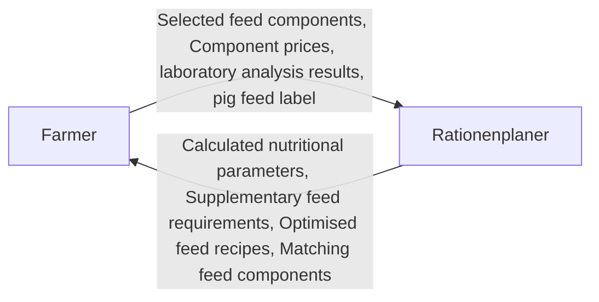
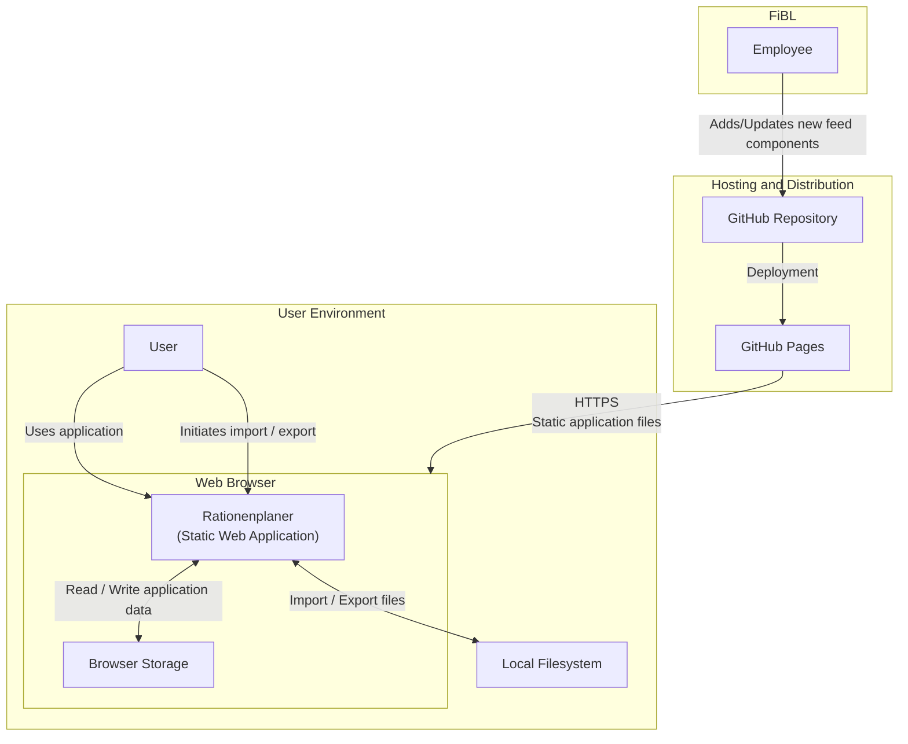

# 3. Context and Scope

* [3.1 Business Context](#31-business-context)
* [3.2 Technical Context](#32-technical-context)
* [3.3 Scope](#33-scope)
* [3.4 Out of Scope](#34-out-of-scope)

This chapter describes the Rationenplaner in its environment. It identifies the interactions with users and external
systems (none so far), the technical interfaces and the boundaries of the system.

## 3.1 Business Context

Rationenplaner supports farmers in formulating, evaluating and optimising pig feed recipes.

The farmer interacts directly with Rationenplaner. The main information exchanged across the system boundary is shown
below.

### Business Interfaces

| Communication Partner | Input to Rationenplaner        | Output from Rationenplaner                                         |
|-----------------------|--------------------------------|--------------------------------------------------------------------|
| Farmer                | Selected Components + kg       | Nutritional analysis +  Supplementary feed requirements on request |
| Farmer                | Selected Components + optimise | Optimised feed recipe + Nutritional analysis                       |
| Farmer                | Laboratory analysis results    | Matching feed components with completed nutritional values         |
| Farmer                | Pig feed label                 | Reengineering the complete nutritional analysis                    |
| Farmer                | Request to print Recipe        | Printable Recipe                                                   |

The Rationenplaner uses nutritional models and feed material information to perform its calculations. These are provided
as part of the application and do not require communication with external agricultural information systems at runtime.

## 3.2 Technical Context

The Rationenplaner is a static web application deployed via GitHub Pages. It executes entirely in the user's web browser
and does not require a backend or central database.

Application data is stored locally in the browser. Users can explicitly export and import their data using files, for
example to create backups or transfer data between devices.

The following diagram illustrates the technical environment and the relevant technical interfaces.

### Technical Interfaces

| External System / Component | Interface / Channel | Description                                                                                                    |
|-----------------------------|---------------------|----------------------------------------------------------------------------------------------------------------|
| GitHub Repository           | Git / HTTPS         | Hosts the source code and project documentation. Serves as the source for application releases and deployment. |
| GitHub Pages                | HTTPS               | Hosts and distributes the static web application.                                                              |
| Web Browser                 | Browser runtime     | Executes the application and provides access to browser APIs.                                                  |
| Browser-local Storage       | Browser Storage API | Persists application data locally on the user's device.                                                        |
| Local Filesystem            | Browser file APIs   | Allows users to import and export application data.                                                            |

The application does not communicate with a backend or external business systems during normal operation. In particular,
there is no central data storage or synchronisation between users or devices.

## 3.3 Scope

Rationenplaner provides the following functionality:

### Recipes

- Select feed components from a predefined list.
- Define custom feed components.
- Combine feed components into feed recipes.
- Calculate feed prices based on user-entered component prices.
- Print a recipe

### Nutritional evaluation

- Calculate nutritional values for feed recipes, covering currently 64 parameters and four pig feed profiles: piglet,
  fattening, gestation and lactation feed.
- Compare calculated values with reference values and predefined feeding recommendations and highlight value below or
  above recommended ranges.
- Compare nutritional values based on a dry matter content of 88%.
- Optimise feed recipes based on nutritional requirements and selected feed components.
- Calculate the nutritional profile of an optimal supplementary feed for an existing feed mixture, for example, a
  mixture produced from farm-grown components.
- Identify feed components that most likely match laboratory analysis results and complete their missing nutritional
  values.
- Calculate nutritional values for a feed mixture based on the information provided on its feed label (if time/budget
  permits)

## 3.4 Out of Scope

The following are not part of the current system scope:

- User accounts and authentication. The application can be used anonymously.
- Server-side processing and central data storage. Users are responsible for managing their data through browser storage
  and import/export.
- Recipe version history: The application does not maintain historical versions of recipes or track changes over time.
  Users are responsible for manually exporting recipes if they wish to retain previous versions.
- Automatic backup of user entered data.
- Automatic synchronisation of data across devices.
- Automatic updates of feed databases from external systems.
- Direct integration with external agricultural or laboratory systems.
- Multi-objective optimisation based on criteria other than nutritional requirements, such as:
    - Minimising feed costs or achieving a target price.
    - Maximising the use of available inventory or restricting component quantities based on stock levels.
    - Minimising environmental impact.
    - Optimising animal performance indicators such as growth rate or feed conversion ratio beyond the defined
      nutritional requirements.
    - Applying preferences based on feed origin, suppliers or procurement conditions.
- Offline support: a user can download the website but would need a local server to not run into CORS issues. Even
  then, lifecycle management is not given:
    - Downloaded instances are standalone snapshots of the static website
    - They are not connected to the deployed web application.
    - Automatic update checks, update notifications and automatic updates are not provided.
    - Users are responsible for manually obtaining newer versions.
- French and Italian user interface translations: The application interface is currently provided in English and German
  only.
- Optimisation for tablets and mobile devices: The application is designed primarily for desktop use and will not be
  specifically adapted for smaller screens, such as tablets and smartphones.
- Dark/Light mode: the application will come in one style only.
- Accessibility: The application will not include specific adaptations to meet accessibility requirements or standards
  (e.g. WCAG or EN 301 549 (EU)). It will neither accommodate users with disabilities nor support usage scenarios
  outside a traditional desktop environment (e.g. operation while wearing gloves).
- Backward compatibility and data migration: Changes to the data schema may render recipes
  created with previous versions unusable. No migration mechanisms are provided.
- Notifications about changes to component data, nutritional algorithms or feed recommendations or the like.
  Consequently, recalculating an existing recipe after an application update may produce different nutritional values
  than before, without explicitly notifying the user.
- In-app release notes or notifications describing changes between application versions.
- Explanations of the potential consequences of nutritional values outside recommended ranges (e.g. toxicity, poor fat
  quality or other adverse nutritional effects). The application identifies deviations from nutritional requirements but
  does not provide veterinary or nutritional advice about their consequences.
- Audit trail documenting the origin, modification history or verification status of individual feed components and
  their nutritional values.

Potential future extensions, such as integration with updated Agroscope feed databases or additional functionality for
agricultural education, advisory services and research, are not part of the current scope. Their implementation depends
on future requirements and available funding.
