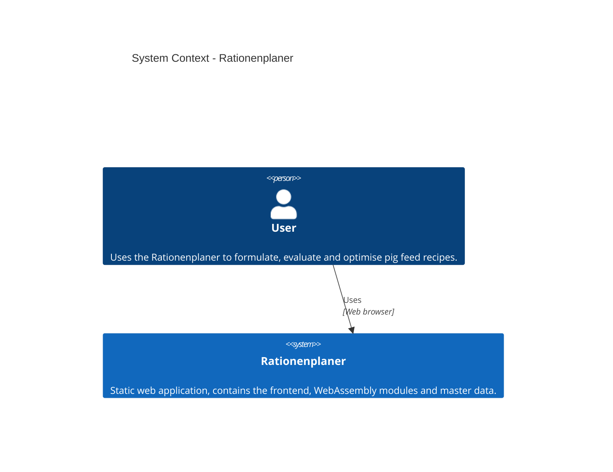
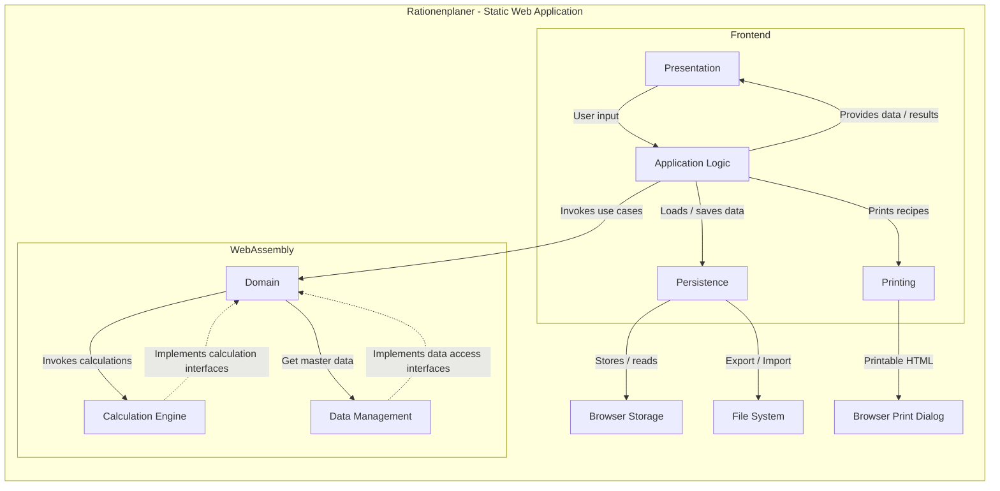

# 5. Building Block View

This chapter describes the static structure of the Rationenplaner and its decomposition into building blocks.

## 5.1 System Context

The Rationenplaner is a static single page application without authentication (and hence without different roles).

## 5.2 Level 2 – Container

One single page application (SPA), i.e. one logical container consisting of index.html + CSS/JavaScript + images + wasm

## 5.3 Level 3 – Components

The Rationenplaner is decomposed into four frontend components and
three logical components within the WebAssembly module. It follows the onion architecture.

### Presentation

The Presentation component is responsible for the application's user interface and interaction with the user.
It is implemented as a single-page application (SPA).

Its responsibilities include:

- Rendering the application interface.
- Handling user interactions and collecting user input.
- Displaying application data, including feed recipes and feed components.
- Presenting nutritional evaluations and optimisation results.
- Displaying validation errors and application feedback.

Presentation is independent of the underlying application workflows and business rules.
It delegates application operations to the Application Logic.

### Application Logic

The Application logic provides the application's use cases and coordinates interactions between the
Presentation,
Domain, Printing and Persistence components.

Its responsibilities include:

- Providing application operations to the Presentation component.
- Coordinating application workflows and use cases.
- Retrieving and managing application data through the appropriate components.
- Invoking domain functionality for recipe validation, nutritional evaluation and optimisation.
- Coordinating the loading and saving of recipes.
- Handling application-level errors and returning results to Presentation.

Application Logic is independent of the presentation framework and does not implement domain-specific business rules.

### Printing

The Printing component provides functionality for printing feed recipes.

Its responsibilities include:

- Preparing recipes for printing.
- Rendering printable recipe layouts.
- Invoking the browser's printing functionality.

### Persistence

The Persistence component is responsible for persisting and exchanging user-specific application data.

Its responsibilities include:

- Persisting application data in browser storage.
- Loading previously stored application data.
- Providing import and export functionality using browser file APIs.

Persistence abstracts the underlying storage mechanism from the Application Logic.

### Domain

The Domain component encapsulates the business rules and domain-specific functionality of the Rationenplaner.

Its responsibilities include:

- Representing domain concepts such as feed recipes, feed components and pig profiles.
- Enforcing domain invariants and business rules.
- Validating feed recipes against domain-specific constraints.
- Coordinating domain operations that require nutritional calculations or optimisation.
- Interpreting and validating calculation results.

The Domain is independent of presentation and infrastructure concerns.
It defines the interfaces required to access external data and
delegates computational operations to the Calculation Engine.

### Calculation Engine

The Calculation Engine provides the specialised computational functionality required by the domain.

Its responsibilities include:

- Calculating nutritional values of feed recipes.
- Evaluating nutritional values against reference values and feeding recommendations.
- Calculating supplementary feed requirements.
- Optimising feed recipes based on nutritional requirements.
- Identifying matching feed components based on laboratory analysis results.
- Performing other computational operations required by the application.

The Calculation Engine is implemented in Kotlin and compiled to WebAssembly (and thus executed locally in the
user's browser, i.e. it does not communicate with external systems).
It is invoked by the Domain and does not directly interact with the Presentation or Persistence components.

### Data Management

The Data Management component manages and provides access to reference data required by the domain.

Its responsibilities include:

- Providing feed component master data.
- Providing pig profiles and feeding recommendations.
- Managing other reference data required for feed formulation.
- Implementing the data access interfaces defined by the Domain.

Data Management abstracts the underlying source of reference data from the Domain.

## 5.4 Level 4 – Code

The Application Logic is written in TypeScript (i.e. JavaScript in the end) and thus won't be able
to invoke the Domain passing Kotlin objects directly. The WebAssembly Module will provide a `JsAdapter` which translates
the JavaScript calls to Kotlin Domain models (omitted in [5.3 Level 3](#53-level-3--components)).

More details regarding code structure is omitted on purpose for now.
