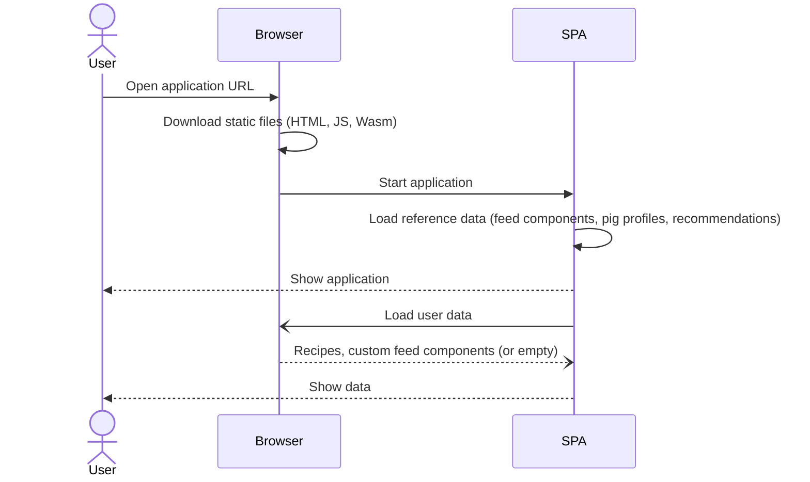
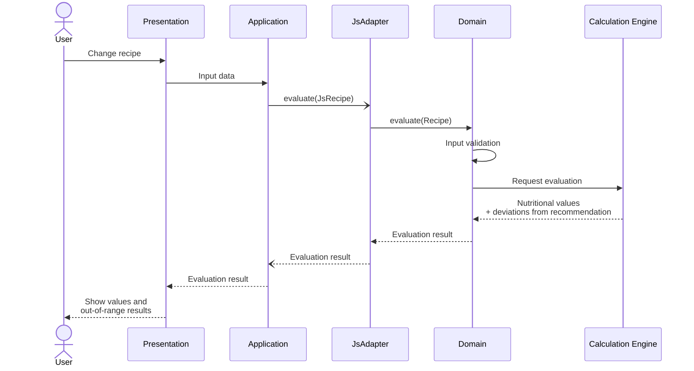

# 6. Runtime View

This chapter shows the most important runtime scenarios.

## 6.1 Application Start

## 6.2 Recipe interactions

Following we show the use case of a recipe being evaluated.
This process is triggered when the user changes a recipe (e.g. adds a component, changes an amount etc.).
The flow is the same for several processes involving a recipe or feed components (optimise a recipe, supplementary feed,
search a match for a laboratory analysis result, pig feed label derivation etc.).

On invalid input or a calculation error, no result is shown. The user sees an explanatory message instead
(see [8.6 Validation and Error Handling](../08-crosscutting-concepts/crosscutting-concepts.md#86-validation-and-error-handling)).
