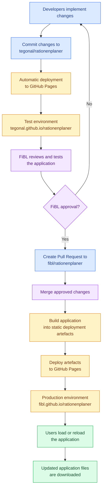

# 7. Deployment View

This chapter describes the deployment structure of Rationenplaner, including the infrastructure, runtime environments
and distribution mechanisms.

## 7.1 Infrastructure Overview

The production deployment consists of three main environments:

1. **Source and development environment:** The GitHub repository hosts the source code, application assets, master data,
   project documentation and technical documentation.
2. **Hosting and distribution environment:** GitHub Pages hosts and distributes the compiled static application.
3. **User environment:** The user's web browser downloads and executes the application. Application data is persisted
   locally in the browser and supports export/import to/from filesystem.

See the diagram
in [Context and Scope => 3.2 Technical context](../03-context-and-scope/context-and-scope.md#32-technical-context)
which illustrates deployment architecture.

There is no runtime communication between the application and the GitHub repository or GitHub Pages.

## 7.2 Deployment Units

Rationenplaner is deployed as a single static web application to github-pages

## 7.3 Deployment Environment

### 7.3.1 Hosting Environment

GitHub Pages, kind of self-speaking as a reminder:

- No application server or backend runtime.
- No central database.
- No server-side processing of user data.
- No user authentication or session management.

### 7.3.2 User Environment

The application executes entirely within the user's web browser.
Browser support according
to [02 Constraints -> TC-02 Browser compatibility ](../02-constraints/constraints.md#tc-02-browser-compatibility)

## 7.4 Data Persistence and Distribution

Application data is stored locally within the user's browser environment.
The deployment architecture deliberately avoids centralised data storage and synchronisation services.

The following principles apply:

- User-entered data remains within the user's browser or local environment.
- No user data is transmitted to the hosting infrastructure.
- No central database or synchronisation mechanism is provided.
- The application must not transmit user data to third-party services.
- Users are responsible for creating backups and transferring data between devices.
- Data exchange between devices is performed explicitly through the export/import functionality.
- Browser storage is used for local persistence, it's the user's responsibility to not clear it.

The hosting environment distributes application files only. It does not participate in application data persistence.

## 7.5 Deployment and Updates

The GitHub repository ([fibl/rationenplaner](https://github.com/fibl/rationenplaner)) is the source of truth for the
application code and deployment artefacts.

The deployment process can be summarised as follows (see diagram below for a visual representation):

1. Developers implement and commit changes in [tegonal/rationenplaner](https://github.com/tegonal/rationenplaner) and
   are automatically pushed to its github-page (this acts as test
   environment): <https://tegonal.github.io/rationenplaner>
2. Once FiBL is happy a PR is created for [fibl/rationenplaner](https://github.com/fibl/rationenplaner)
3. The application is built into static deployment artefacts.
4. The resulting artefacts are deployed to GitHub Pages.
5. Users access the application through the published HTTPS endpoint.
6. When a new version is deployed, users receive the updated application files when they load or reload the hosted
   application (no push)

The deployment process does not require database migrations, backend service restarts or infrastructure provisioning.
Data migration in the client (due to schema changes) are out of scope
(see [3.4 Out of Scope](../03-context-and-scope/context-and-scope.md#34-out-of-scope)).

**Note:** The exact CI/CD workflow, build triggers and deployment branch configuration are implementation details of the
repository and are not architectural requirements of the deployment model.

## 7.6 Operational Considerations

The deployment architecture intentionally minimises operational complexity.

The following operational characteristics are relevant:

| Aspect            | Description                                                                                        |
|-------------------|----------------------------------------------------------------------------------------------------|
| Availability      | Availability of the hosted application depends on GitHub Pages and the user's internet connection. |
| Scalability       | Static file distribution avoids application-server scaling and central processing bottlenecks.     |
| Performance       | Application execution and nutritional calculations take place locally in the browser.              |
| Data protection   | User-entered data is not centrally collected or stored.                                            |
| Backup            | Users are responsible for exporting and backing up their application data.                         |
| Updates           | Hosted instances receive updated application files through redeployment.                           |
| Monitoring        | No central application monitoring or user-data collection is required by the architecture.         |
| Operational costs | Static hosting avoids the costs of maintaining application servers and databases.                  |

### Deployment Failure Scenarios

The deployment architecture has the following relevant failure scenarios:

| Failure Scenario                       | Impact                                                         | Mitigation / Behaviour                                                                                             |
|----------------------------------------|----------------------------------------------------------------|--------------------------------------------------------------------------------------------------------------------|
| GitHub Pages unavailable               | Users cannot access or download the hosted application.        | Mitigations out-of-scope (offline support). If the user has already opened the app then it keeps working           | 
| Internet connection unavailable        | The hosted application cannot initially be loaded or updated.  | See above                                                                                                          |
| Browser storage unavailable or cleared | Locally persisted application data may be unavailable or lost. | Users should regularly export their data and maintain backups. Warn the user on first usage                        |
| Incompatible browser version           | Application functionality may be impaired.                     | Use one of the supported browser versions. We don't warn the user.                                                 |
| Failed deployment                      | The latest application version may not become available.       | The previously published static application remains the intended production version until a successful deployment. |
